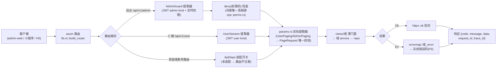

# 01 · HTTP 门面层(http-api)

> 覆盖:`backend/crates/http-api/`(聚合 API 薄层)。核对入口:`src/lib.rs` 的 `build_router`。
> 规则归属:信封与错误码表冻结(F6)、分页双轨唯一校验(F6)见蓝图;本文只导航。

## 1. 目录结构与职责

```text
http-api/src/
├── lib.rs         # build_router:路由汇总 + 中间件 + 健康检查 + 静态资源
├── state.rs       # ApiDeps + 各域最小 Handles + FromRef 子状态(装配开关在此)
├── errormap.rs    # 域错误 → 错误码映射唯一枢纽 + rid_of/bearer/respond 原语
├── guard.rs       # AdminGuard 提取器(JWT admin kind + 实时权限)
├── user_guard.rs  # UserSession 提取器(C 端 JWT user kind)
├── params.rs      # 分页/时间/状态过滤双轨参数提取器(UserPaging/AdminPaging/StatusFilter)
└── views/<域>/    # 12 域 × {admin.rs, user.rs, mod.rs}:每域两个薄门面
```

要点:

- **条件装配**(state.rs + lib.rs):`wallet::user::refund_router`、`payment::user::checkout_router`、`charging::user::stop_router` 依 `ApiDeps` 对应字段是否为 `Some` 决定是否注册路由;配套的 `WalletState`/`PaymentState`/`ChargingStopState` 三个 FromRef 用 expect 落实「开关开启后取用必达」(票 17 形态,新增域照此 checklist,不再写运行时 Option 降级)。生产装配(`app::serve`)下三者恒为 `Some`,开关主要服务于测试装配。
- **模拟支付特殊**:`payment::user::simulation_router` 无条件 merge,handler 内按 `simulation_payment` 布尔(`PaymentMode::Simulation`)裁决,关闭时 404。
- **错误映射枢纽**(errormap.rs):每个域错误类型一个映射函数(如 `identity_error`/`wallet_error`),handler 出错统一走 `errormap::<域>_error(e, rid)`;注意 `WalletError` 有两个映射函数(`wallet_error` C 端 / `risk_error` 后台),这是保留契约差异的有意形态。`rid_of`(请求 ID)、`bearer`(令牌提取)、`respond`(信封写出)也住在 errormap。
- **权限模型**:后台每个 handler 以 `deny(&guard, perms::XXX, &rid)` 起手(权限码词表唯一真相源是 `modules/ops/src/perms.rs`);用户端经 `user_guard.rs` 提取器鉴权。

## 1.5 请求处理管线



## 2. 路由总览

共 **122 条 route 注册,按方法拆开 139 个业务端点**。前缀约定:`/api/v1/admin/*` 后台、`/api/v1/user/*` C 端(H5/小程序)。响应统一信封 `{code, message, data, request_id, trace_id, errors?}`。

### ops — 后台运营与鉴权(25 端点)

| 方法 | 路径 | 功能 |
|---|---|---|
| POST | /api/v1/admin/auth/login | 管理员口令登录(可触发 MFA 挑战) |
| POST | /api/v1/admin/auth/mfa | 登录第二步 MFA 验证码校验 |
| POST | /api/v1/admin/auth/refresh | 刷新管理员访问令牌 |
| POST | /api/v1/admin/auth/logout | 注销刷新令牌 |
| GET | /api/v1/admin/auth/me | 当前管理员信息与权限 |
| GET/POST | /api/v1/admin/admin-users | 后台账号列表 / 创建 |
| PUT/DELETE | /api/v1/admin/admin-users/{id} | 更新 / 删除后台账号 |
| POST | /api/v1/admin/admin-users/{id}/unlock | 解除账号登录锁定 |
| POST | /api/v1/admin/admin-users/{id}/reset-password | 重置后台账号口令 |
| POST | /api/v1/admin/admin-users/{id}/mfa | 管理指定账号 MFA |
| GET/POST | /api/v1/admin/auth/mfa-settings | 本人 MFA 状态 / 设置(enrol/confirm/disable) |
| GET/POST | /api/v1/admin/roles | 角色列表 / 创建角色 |
| PUT/DELETE | /api/v1/admin/roles/{id} | 更新 / 删除角色 |
| GET | /api/v1/admin/permissions | 权限清单 |
| GET/POST | /api/v1/admin/announcements | 公告列表 / 发布公告 |
| GET | /api/v1/admin/dashboard | 运营仪表盘汇总 |
| GET | /api/v1/admin/diagnostics | 系统诊断(兜底扫描快照 + 队列深度) |
| GET | /api/v1/admin/audit-logs | 审计日志分页查询 |
| GET | /api/v1/user/announcement/list | C 端公告分页列表 |

### identity — C 端身份(9 端点)

| 方法 | 路径 | 功能 |
|---|---|---|
| POST | /api/v1/user/auth/login | C 端登录(wx code 经 login_mode 交换器换会话) |
| POST | /api/v1/user/auth/refresh | 刷新 C 端令牌 |
| POST | /api/v1/user/auth/logout | 注销 C 端会话 |
| GET | /api/v1/user/profile | 当前用户资料 |
| POST | /api/v1/user/phone/bind | 绑定手机号(成功仅返回掩码) |
| POST | /api/v1/user/phone/unbind | 解绑手机号(重复解绑同样成功) |
| GET | /api/v1/admin/users | 用户列表(admin) |
| GET | /api/v1/admin/users/{id} | 用户详情(admin) |
| GET | /api/v1/admin/users/{id}/recharges | 该用户充值记录(admin) |

### device — 站点/设备/工单/告警(30 端点)

| 方法 | 路径 | 功能 |
|---|---|---|
| GET/POST | /api/v1/admin/stations | 充电站列表 / 创建 |
| GET/PUT | /api/v1/admin/stations/{id} | 站点详情 / 更新 |
| GET/POST | /api/v1/admin/vendors | 厂商列表 / 创建 |
| GET/PUT | /api/v1/admin/vendors/{id} | 厂商详情 / 更新 |
| GET | /api/v1/admin/vendor-options | 厂商下拉选项 |
| GET | /api/v1/admin/devices | 设备列表 |
| GET/PUT | /api/v1/admin/devices/{id} | 设备详情 / 更新(乐观锁) |
| PUT | /api/v1/admin/devices/{id}/status | 设备启停状态 |
| GET/POST | /api/v1/admin/device-imports | 批量导入记录 / 发起导入 |
| POST | /api/v1/admin/device-imports/{import_id}/retry | 重试导入 |
| GET | /api/v1/admin/device-fault-reports | 故障工单列表 |
| GET | /api/v1/admin/device-fault-reports/{id}/history | 工单处理历史 |
| POST | /api/v1/admin/device-fault-reports/{id}/dispatch | 工单派单 |
| POST | /api/v1/admin/device-fault-reports/{id}/resolve | 工单结案 |
| GET | /api/v1/admin/alerts | 告警列表 |
| POST | /api/v1/admin/alerts/{id}/ack | 告警确认 |
| GET | /api/v1/admin/settings/device-capabilities | 设备能力清单 |
| GET | /api/v1/user/station/nearby | 附近站点检索 |
| GET | /api/v1/user/station/{id} | 站点详情(含端口) |
| POST | /api/v1/user/device/report-fault | 提交故障报修 |
| GET | /api/v1/user/device/fault-reports | 我的报修列表 |
| GET | /api/v1/user/device/fault-reports/{id}/history | 我的报修历史 |
| POST | /api/v1/user/scan/resolve | 扫码解析(裸码/HTTPS 链接→设备或端口,匿名) |
| POST | /api/v1/user/scan/port | 端口编码查询单端口(匿名) |

### charging — 充电查询与停止(8 端点)

| 方法 | 路径 | 功能 |
|---|---|---|
| GET | /api/v1/user/charge/ongoing | 充电中订单 |
| GET | /api/v1/user/charge/ongoing/snapshot | 实时快照(轮询提示 + 2 分钟窗口 + 估费) |
| GET | /api/v1/user/charge/ongoing/curve | 实时曲线(last_30min/last_2h/last_24h) |
| GET | /api/v1/user/charge/history | 历史订单分页 |
| GET | /api/v1/user/charge/{order_no}/curve | 历史订单功率曲线 |
| GET | /api/v1/user/charge/{order_no} | 订单详情(base + 支付摘要 + 退款列表) |
| POST | /api/v1/user/charging/{order_no}/stop | 用户停止(新路径)【条件注册:charging_stop】 |
| POST | /api/v1/user/charge/stop | 用户停止(旧形状,小程序在用)【条件注册:charging_stop】 |

### payment — 下单与支付(4 端点)

| 方法 | 路径 | 功能 |
|---|---|---|
| POST | /api/v1/user/scan/offers | 端口套餐与展示配置(免登录)【条件注册:checkout】 |
| POST | /api/v1/user/scan/start | 下单与支付准备(冻结意图与计费快照)【条件注册:checkout】 |
| POST | /api/v1/user/wallet/recharge | 钱包充值下单【条件注册:checkout】 |
| POST | /api/v1/user/development/payments/confirm | 模拟支付确认(simulation 模式,否则 404) |

### wallet — 钱包与风控(8 端点)

| 方法 | 路径 | 功能 |
|---|---|---|
| GET | /api/v1/user/wallet/balance | 钱包余额 |
| GET | /api/v1/user/wallet/txns | 钱包流水 |
| GET | /api/v1/user/wallet/recharges | 充值记录 |
| GET | /api/v1/user/wallet/refunds | 退款记录 |
| POST | /api/v1/user/wallet/refund | 余额退款申请(同请求号幂等;3 次/5 分钟触发频次冻结转人工)【条件注册:wallet】 |
| GET | /api/v1/admin/billing/wallet-risks | 钱包风控审核列表 |
| POST | /api/v1/admin/billing/wallet-risks/{request_id}/review | 风控审核(需 finance 权限) |
| POST | /api/v1/admin/billing/wallet-risks/{request_id}/release | 风控释放 |

### order — 订单与反馈(9 端点)

| 方法 | 路径 | 功能 |
|---|---|---|
| GET | /api/v1/user/charge/{order_id}/feedback | 订单评价/反馈 |
| GET | /api/v1/admin/feedback | 反馈列表 |
| POST | /api/v1/admin/feedback/{id}/reply | 回复反馈 |
| GET | /api/v1/admin/orders | 订单列表 |
| GET | /api/v1/admin/orders/{id} | 订单详情 |
| GET | /api/v1/admin/orders/{id}/timeline | 订单时间线 |
| GET | /api/v1/admin/orders/{id}/process | 订单处理过程 |
| GET | /api/v1/admin/orders/{id}/refunds | 订单关联退款单(POST 同路径为 settlement 人工退款) |
| GET | /api/v1/admin/payment-orders | 支付单列表 |

### settlement — 账单/发票/退款(17 端点)

| 方法 | 路径 | 功能 |
|---|---|---|
| GET | /api/v1/user/bills | 我的账单分页 |
| GET | /api/v1/user/bills/{id} | 账单详情(越权/不存在统一 404) |
| POST | /api/v1/user/bills/{id}/read | 账单已读标记(幂等) |
| POST | /api/v1/user/invoice/apply | 提交开票申请(金额由订单回执确定) |
| GET | /api/v1/user/invoice/my | 我的发票申请分页 |
| GET | /api/v1/admin/billing/invoices | 发票申请列表 |
| POST | /api/v1/admin/billing/invoices/{id}/approve | 发票审核通过(需 invoice.review) |
| POST | /api/v1/admin/billing/invoices/{id}/reject | 发票驳回 |
| GET | /api/v1/admin/billing/meter-reviews | 电表读数复核列表 |
| POST | /api/v1/admin/billing/meter-reviews/{id}/propose | 提出修正读数提案 |
| POST | /api/v1/admin/billing/meter-reviews/{id}/decide | 复核决定 |
| POST | /api/v1/admin/billing/meter-reviews/{id}/resolve-amount | 修正金额裁定 |
| GET | /api/v1/admin/billing/refunds | 退款单列表 |
| POST | /api/v1/admin/billing/refunds/{refund_no}/approve | 退款审批(双人复核) |
| POST | /api/v1/admin/billing/refunds/{refund_no}/reject | 退款驳回 |
| POST | /api/v1/admin/billing/refunds/{refund_no}/retry | 退款重试 |
| POST | /api/v1/admin/orders/{id}/refunds | 发起人工退款 |

### pricing — 计费方案(9 端点)

| 方法 | 路径 | 功能 |
|---|---|---|
| POST | /api/v1/admin/settings/charging-schemes/preview | 方案试算预览 |
| GET/POST | /api/v1/admin/settings/charging-schemes | 方案列表 / 创建 |
| PUT/DELETE | /api/v1/admin/settings/charging-schemes/{id} | 更新 / 删除方案 |
| POST | /api/v1/admin/settings/charging-schemes/{id}/status | 启用/停用 |
| POST | /api/v1/admin/settings/charging-schemes/apply | 应用方案到站点 |
| GET | /api/v1/admin/stations/{id}/charging-scheme | 查询站点生效方案 |
| POST | /api/v1/admin/stations/{id}/charging-scheme/inherit | 站点方案改继承默认 |

### marketing — 优惠券(10 端点)

| 方法 | 路径 | 功能 |
|---|---|---|
| GET/POST | /api/v1/admin/coupons | 券模板列表 / 创建 |
| PUT | /api/v1/admin/coupons/{id} | 更新券模板 |
| GET | /api/v1/admin/coupons/{id}/stats | 券发放/使用统计 |
| POST | /api/v1/admin/coupons/{id}/grants | 向用户发券 |
| GET/POST | /api/v1/admin/coupon-activities | 券活动列表 / 创建 |
| PUT | /api/v1/admin/coupon-activities/{id} | 更新活动 |
| GET | /api/v1/user/coupon/my | 我的券列表 |
| GET | /api/v1/user/coupons | 可领券列表 |

### card — 在线卡(5 端点)

| 方法 | 路径 | 功能 |
|---|---|---|
| GET | /api/v1/admin/online-cards | 在线卡列表 |
| POST | /api/v1/admin/online-cards/bind | 绑定在线卡(32 位卡号 + 核验依据) |
| POST | /api/v1/admin/online-cards/{id}/status | 在线卡状态变更 |
| GET | /api/v1/user/cards | 我的卡列表 |
| POST | /api/v1/user/cards/{card_no}/status | 挂失/解绑本人卡(仅 lost/unbound) |

### export — 数据导出(5 端点,均 admin)

| 方法 | 路径 | 功能 |
|---|---|---|
| GET/POST | /api/v1/admin/exports | 导出任务列表 / 创建任务 |
| GET | /api/v1/admin/exports/resources | 可导出资源清单 |
| GET | /api/v1/admin/exports/{id} | 导出任务详情 |
| GET | /api/v1/admin/exports/{id}/download | 下载导出文件 |

### 非业务路由

| 方法 | 路径 | 功能 |
|---|---|---|
| GET | /health/live | 存活探针,恒 "ok" |
| GET | /health/ready | 就绪探针:`SELECT 1` + Redis PING,双通 "ok",否则 "degraded" |
| GET | /metrics | Prometheus 指标 |
| GET | /admin/** 与 /h5/** | 前端静态资源(rust-embed 编译期嵌入,SPA fallback)【产物非空才挂载】 |
| * | 未匹配任意路径 | 统一 404 信封(带 request_id) |

## 3. 加一个端点的固定动作清单

1. `views/<域>/{admin,user}.rs` 写 handler(门面薄:参数提取 → 域 service 调用 → errormap 错误映射);
2. `<域>/mod.rs` 挂 router,`lib.rs::build_router` merge(涉资金域先看是否需要条件装配 + FromRef 必达态);
3. 后台端点在 handler 起手加 `deny(&guard, perms::XXX, &rid)`,权限码不在词表则先去 `modules/ops/src/perms.rs` 落码;
4. 分页端点用 `params.rs` 的双轨提取器(UserPaging/AdminPaging),界限值出自 `domain::limits`,不要手写副本;
5. 新错误:域 `error.rs` 定义 → errormap 加映射函数 → 码值核对 `platform::error::Code` 冻结表;
6. 跑 `node tasks.mjs check`(api-contract 对账会核对前端调用点↔路由↔必填字段);测试写法见 [08-testing-gates.md](08-testing-gates.md)。
