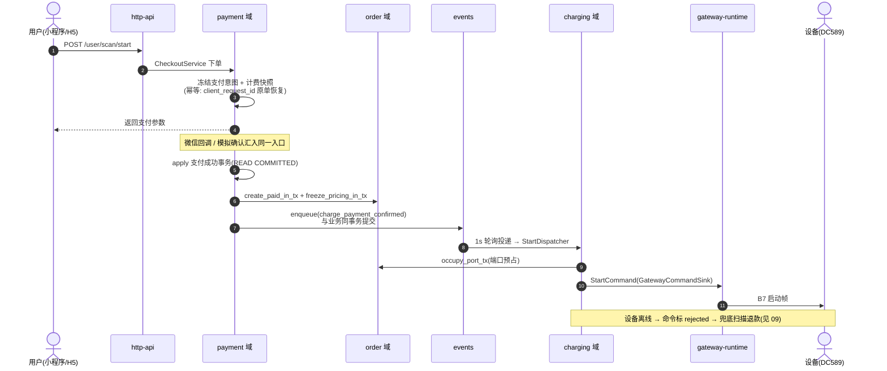
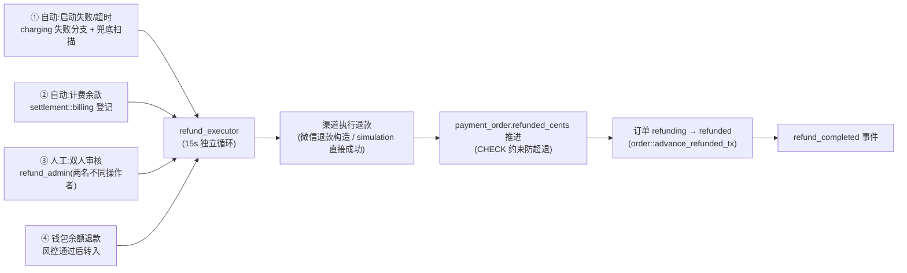

# 02 · 充电核心链路(跨 crate 全时序)

> 覆盖:从「用户扫码」到「订单完结/退款收尾」的完整时序,以及每一步住在哪个 crate 的哪个文件。
> 这是平台的主干业务流,跨越 payment → charging → gateway-runtime → events → order → settlement → wallet 七个 crate。
> 规则归属:状态机定案(ADR 002)、支付成功事务是入口、事件 at-least-once 见蓝图 F3;order 写侧无编排层(原语范式)是评审定案,见蓝图第五章。

## 0.1 全景泳道图:下单支付 → 启动命令



## 0.2 全景泳道图:回执推进 → 停止 → 计费

```mermaid
sequenceDiagram
    autonumber
    actor D as 设备(DC589)
    participant G as gateway-runtime
    participant E as events
    participant C as charging 域
    participant O as order 域
    participant S as settlement 域
    actor U as 用户(小程序/H5)

    D->>G: B8 启动应答(厂商应答码)
    Note over G: 适配器翻译 → 中性 success(码值不进运行时)
    G->>E: 落 device_event + domain_event(同事务)
    E->>C: device_event → handle_start_result
    C->>C: locate_pending_start<br/>(定位最近 sent 命令 + 组装回执输入)
    C->>C: apply_start_receipt 事务<br/>(幂等核对 + 状态必须 paid)
    C->>O: mark_charging_tx(订单 charging) + 端口占用确认
    Note over D,U: 充电中:心跳遥测 → 批量落库与聚合;<br/>C 端轮询 /charge/ongoing/snapshot 读 SnapshotStore
    U->>C: 用户停止(StopService,条件注册路由)
    C->>G: B9 停止帧(停止命令 pending → sent)
    D->>G: BA 停止应答
    G->>C: ack_stop_command(→ Acked/Rejected)
    D->>G: BB 结束上报(计量分段)
    G->>C: apply_end_receipt 事务
    C->>O: complete_tx(订单 completed) + release_port_tx(释放端口)
    C->>S: insert_billing_job_tx(计费任务)
    S->>S: settle_session 纯函数结算<br/>→ 费用回执 + 账单签发(15s 循环)
```

## 0.3 退款汇合流程



## 0. 参与角色速查

| crate | 在本链路中的角色 | 关键入口 |
|---|---|---|
| pricing | 提供计费方案(模板→发布→生效匹配) | `service::{templates, publication}` |
| payment | 下单、冻结计费快照、支付成功事务(状态机入口) | `service::checkout`、`service::apply` |
| charging | 启动命令下发、回执应用、兜底扫描 | `service::dispatch`、`service::receipts`、`service::sweeper` |
| gateway-runtime | 命令下发到设备、设备事件接收 | `command_sink.rs`、`device_events.rs` |
| events | 跨域事件总线(事务内入队 + 异步投递) | `enqueue::in_tx`、`runtime::Registry` |
| order | 订单存储原语(锁状态→构证据→条件 UPDATE) | `repo::lifecycle` |
| settlement | 计费批次、退款执行、账单、发票 | `service::billing`、`service::refund_executor` |
| wallet | 余额支付与退款预占 | `service::recharge`、`service::refund` |

## 1. 阶段一:下单与支付(扫码充电)

```text
用户扫码 → POST /api/v1/user/scan/resolve(device 域,匿名解析端口)
        → POST /api/v1/user/scan/offers(payment::checkout,套餐与展示配置,免登录)
        → POST /api/v1/user/scan/start (payment::checkout::CheckoutService)
              下单即冻结:charge_payment_intent(意图)+ 计费快照;
              相同 client_request_id 可原单号恢复(幂等)
        → 渠道预支付(payment::channel::PayProvider,三模式 disabled/simulation/wechat_direct;
              微信实现 service::wechat,APIv3 签名/验签/回调解密)
        → 支付成功:
              微信回调 或 POST /user/development/payments/confirm(模拟)
              → payment::service::apply::apply_payment_success(统一入口,ADR 002)
                  READ COMMITTED 单事务:
                  支付单锁定 → 回调幂等摘要(payment_callback_idempotent)
                  → 状态推进 → charge 分支:订单创建(order::create_paid_in_tx)
                    + 快照冻结(order::freeze_pricing_in_tx)
                    + 出站事件 charge_payment_confirmed(enqueue::in_tx)
                  wallet 分支:充值入账(见 04-funds-flow.md)
```

**钱包余额支付路径**:刷卡/下单时余额扣款走 `card::service::swipe`(见 05)或 wallet 充值意图,同样汇入 `charge_payment_confirmed` 事件。

## 2. 阶段二:启动命令与回执

```text
events runtime 投递 charge_payment_confirmed
  → charging::service::dispatch::StartDispatcher::dispatch
      校验 paid 订单 → 端口预占(order::occupy_port_tx,active_port_charge)
      → 组装启动命令(charging::sink::StartCommand)
      → 经 GatewayCommandSink 下发(gateway-runtime::command_sink)
          设备离线 → 命令标 rejected → 兜底扫描退款

设备收到 B7 启动帧 → 执行 → 上报 B8 启动应答帧
  → TCP 会话(protocol-dc589::adapter)→ GatewaySink::record(落 device_event + domain_event)
  → events runtime 投递 device_event → DeviceEventDispatcher(gateway-runtime::device_events)
      handle_start_result:
        success 判定由协议适配器翻译(厂商应答码不进运行时);
        旧格式在途载荷无 success → 跳过,兜底扫描接管
        → charging::locate_pending_start(定位最近 sent 命令并组装回执输入,
            port_id = 订单 ID 的表知识在域内)
        → charging::apply_start_receipt(service/receipts.rs,事务内):
            幂等检查(同命令同内容重放静默确认,不同内容 Conflict)
            状态核对(必须 paid)
            成功分支:mark_charging_tx(订单 charging)+ 端口占用确认 + 刷卡首购确认
            失败分支:mark_start_rejected_tx(订单 refunding)+ 渠道退款登记
                      + ChargeStartFailed 事件出站(退款执行器收尾)
```

## 3. 阶段三:充电中(遥测与实时查询)

```text
设备心跳 A4(含端口遥测)→ GatewaySink:
    内存快照先更新(SnapshotStore,毫秒级,只承载显示与估算,不承载资金事实)
    高频遥测 → TelemetryBuffer 有界缓冲 → 批量落 telemetry 表(200ms/500 条触发;
              缓冲满丢最旧明细,ADR 005 分级丢弃)
C 端充电页轮询:
    GET /user/charge/ongoing/snapshot → http-api 读 SnapshotStore(缺失回退查库)
    GET /user/charge/ongoing/curve → 聚合表读取
15 分钟/小时预聚合(容量目标 2000 台支撑手段,蓝图第一章)
```

## 4. 阶段四:停止与结束

```text
用户停止:POST /user/charge/{order_no}/stop 或旧形状 /user/charge/stop
  → charging::service::stop::StopService(条件注册路由)
      find_active_stop(授权查询)→ 幂等复用停止命令(find_stop_command_tx)
      → 登记停止命令(insert_stop_command_tx,Pending)
      → mark_command_stopping_tx + upsert_cutoff_tx(计费截止冻结)
      → 下发 B9 停止帧(GatewayCommandSink)→ mark_stop_command_sent_tx

设备 BA 停止应答 → DeviceEventDispatcher::handle_stop_result
  → charging::repo::stop::ack_stop_command(Pending/Sent → Acked/Rejected)

设备 BB 结束上报 → DeviceEventDispatcher::handle_charge_end
  → charging::find_unreported_stop 定位停止命令
  → charging::apply_end_receipt(事务内):
      幂等(同内容重放确认)→ 状态核对(charging 且已启动)
      → 启动凭据核对 → insert_end_receipt_tx(计量证据)
      → order::complete_tx(订单 completed + kWh 四位定点)
      → release_port_tx(端口释放,必须匹配本订单)
      → insert_billing_job_tx(计费任务,settlement 消费)
      → ChargeEnded 事件出站

自动停机:设备侧充满自停 → 同走 BB;平台侧超时 → 兜底扫描(见阶段六)
```

## 5. 阶段五:计费与结算

```text
billing-loop(15s 节拍,独立循环)→ settlement::service::billing
    领取 pending 计费任务(BillingJobStatus 词表)
    → 读订单/快照/计量 → domain::charging::settle_session(纯函数结算,域 crate 差分验证)
    → 资金同事务:charge_fee_receipt(费用回执,幂等)+ 订单费用列
      + 余款退款登记 + charge_settled 事件 + 账单签发(bill::issue_bill_in_tx)
    → 无效数据转人工(manual_review → meter_review 两条人工出口)
    → 存储错误退避重试
```

## 6. 阶段六:退款与兜底

```text
三条退款来源汇入 settlement::refund_executor(15s 独立循环):
  ① 启动失败/超时自动退款(charging 失败分支登记 / sweeper 兜底)
  ② 计费余款退款(billing 分支登记)
  ③ 人工退款(refund_admin 登记 → 双人审核 → approved)
执行器:领取 pending/automatic 到期退款 → 渠道执行 → 支付单 refunded_cents
  推进(CHECK 保护防超退)→ 订单 refunding → refunded
  → refund_completed 事件

charging-start-timeout 兜底扫描(30s,SweepRegistry):
  sent 命令超时未回执 → 启动命令 rejected → 订单 refunding → 退款登记
  (命令状态机与订单推进的最终兜底,幂等可重入)

钱包余额退款(用户发起)见 04-funds-flow.md,经风控后同样走执行器。
```

## 7. 状态机一览

- **订单(charge_order.status)**:`ChargeOrderStatus`(domain/order)——paid → charging → completed;旁路 refunding → refunded。推进全部走 `order::repo::lifecycle` 条件 UPDATE 原语(`mark_charging_tx`/`mark_start_rejected_tx`/`complete_tx`/`advance_refunded_tx`),写点六处证据类型化(票 14)。
- **启动命令(charge_command.status)**:`ChargeCommandStatus`——pending → sent → acked/rejected/stopping。
- **停止命令(charge_stop_command.status)**:`ChargeStopCommandStatus`——pending → sent → acked/rejected。
- **支付意图**:`PaymentIntentStatus`(唯一属主 payment_intent.rs,票 09)。

## 8. 改这条链路时的注意点

1. **回执幂等红线**:每张回执表同命令同内容重放静默确认、不同内容冲突(receipts.rs 顶部注释);新增回执类型照 `apply_start_receipt` 范式。
2. **端口释放必须匹配订单**:`release_port_tx` 带 order_id 条件,防误释他单。
3. **命令状态机推进走条件 UPDATE**(RowsAffected 语义),不要改成先读后写。
4. **网关层零 SQL**:device_events.rs 只做传输编排,业务查询下沉域 repo(check-sql 门禁把守);sink/telemetry 的运行时存储 SQL 是蓝图豁免面。
5. 计量单位换算(Wh↔mWh、分↔0.1 元)在 protocol-dc589 与 domain(settle_session)边界完成,业务层只见整数分与 Wh。
