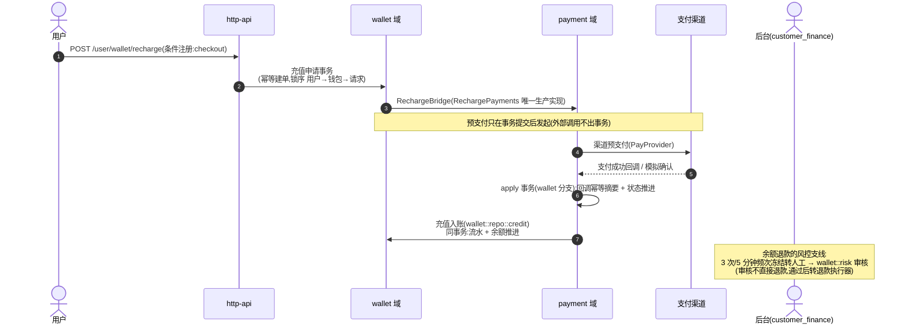

# 04 · 资金链路与纪律(钱包 / 支付 / 退款 / 发票)

> 覆盖:一切动钱的路径——充值、余额扣款、支付意图、退款、账单、发票、风控。
> 规则归属:资金纪律是蓝图 F7 红线(金额 int64 分 + decimal 中间计算;幂等表原样保留;行锁顺序不重排);硬规则见 CODING_STANDARDS.md。
> **改本图覆盖的任何代码前,先读完第 4 节清单。**

## 1. 资金域角色与表

| crate | 角色 | 拥有的表(写入权) |
|---|---|---|
| wallet | 余额账户、充值申请、退款预占、频次风控 | wallet_account、wallet_txn、wallet_recharge_request、wallet_refund_request、wallet_refund_part、wallet_risk_freeze_link、wallet_risk_review、wallet_risk_release、risk_freeze_log |
| payment | 支付意图、渠道、支付成功处理 | payment_order、charge_payment_intent、charge_prepay、payment_callback_idempotent |
| settlement | 计费批次、退款执行、账单、发票、人工复核 | charge_billing_job、charge_fee_receipt、charge_bill、refund_record、charge_manual_settlement、charge_meter_review、invoice_request、invoice_admin_review、manual_fee_review、manual_refund_request、refund_review、refund_rejection、charge_bill_read |
| card | 在线卡扣款(资金动作发生在 swipe 事务内) | online_card、card_operation、card_charge、online_card_audit、card_event_delivery |
| order | 订单资金列推进(refunded_cents 等,经原语) | charge_order(资金列)、charge_order_pricing、charge_event_log |

## 1.5 充值泳道图



## 2. 充值链路(钱包充值)

```text
POST /user/wallet/recharge【条件注册:checkout】
  → wallet::service::recharge(充值申请事务):
      幂等建单(同请求号复用)→ 支付单复用与提交 → 锁序 用户→钱包→请求
      → 事务提交后才发起预支付(外部调用不出事务)
  → payment::service::recharge_bridge(RechargePayments 的唯一生产实现)
      → 渠道预支付(PayProvider)
  → 支付成功回调 / 模拟确认
      → payment::service::apply(wallet 分支):充值入账(wallet::repo::credit)
      → 事务内钱包流水 + 账户余额推进
```

## 3. 退款链路(三条来源,一个执行器)

```text
来源 A:充电链路自动退款(启动失败/超时/计费余款)
    charging 失败分支 / settlement::billing 登记渠道退款记录
    → settlement::service::refund_executor 领取执行

来源 B:人工退款
    POST /admin/orders/{id}/refunds → settlement::service::refund_admin
    登记 → 双人审核(第一人 awaiting_second,第二人 approved;不同操作者)
    → 同一执行器

来源 C:钱包余额退款(用户发起)
    POST /user/wallet/refund【条件注册:wallet】
    → wallet::service::refund:同请求号幂等;3 次/5 分钟触发频次冻结转人工
    → 原路拆单预占(锁序 钱包→申请→充值支付→在途退款)
    → accepted = 已预占,manual_review = 待人工
    → wallet::service::risk 审核(customer_finance/customer_cs)与解冻
      (审核不直接退款——通过后转退款执行)

执行器:settlement::service::refund_executor(15s 独立循环)
    领取 pending/automatic 到期 → 渠道执行(微信退款构造在 payment::service::wechat;
    simulation 通道直接成功)
    → payment_order.refunded_cents 推进(CHECK 约束防超退)
    → order::advance_refunded_tx(订单 refunding → refunded)
    → refund_completed 事件
```

## 4. 资金纪律清单(红线,改代码前逐条对照)

### 4.1 金额与单位

- 一切金额 **int64 分**存储;中间计算用 decimal(rust_decimal),出口转回分。
- 电量 Wh 整数;Wh→kWh 展示换算在出口做四位定点(见 charging::apply_end_receipt)。
- 单位换算收敛:遥测指标换算在 domain(protocol-dc589 边界换 mWh),业务层不见原始协议单位。

### 4.2 幂等表(原样保留,F7)

| 幂等表/键 | 防什么 |
|---|---|
| payment_callback_idempotent | 渠道回调重放 |
| charge_start_receipt / charge_end_receipt(uk_command) | 设备回执重投(同内容静默,异内容冲突) |
| card_operation.event_id(uk_device_event) | 刷卡事件重放 |
| wallet_recharge_request / wallet_refund_request(同请求号) | 用户端重试 |
| 发放号 = sha256(规则+用户+事件键)(marketing) | 活动触发重复发券 |
| invoice uk_invoice_active | 一单一申请 |

新增写路径:先找幂等键,没有就设计一个;不要靠「前端不会重复提交」。

### 4.3 锁序(不重排,F7)

| 路径 | 锁序 |
|---|---|
| payment 支付成功事务 | 支付单 → 意图 → (wallet 充值)申请与钱包 |
| card 刷卡准入 | 卡 → 钱包 → 会话 → 订单 |
| wallet 充值申请 | 用户 → 钱包 → 请求 |
| wallet 余额退款 | 钱包 → 申请 → 充值支付 → 在途退款 |
| settlement 计费 | 订单 → 支付单 → 退款在途 |
| settlement 退款执行/人工 | 退款记录 → 支付单 → (钱包);人工退款为 支付 → 退款 |
| ops 后台账号管理 | customer_admin 角色行 → 操作者 → 目标行 |

各域 lib.rs 顶部注释是锁序文档位;**跨域资金推进前必须持前序锁**(如推进 refunded_cents 前持支付单锁)。行锁用 `SELECT ... FOR UPDATE` 原语(lock_*_tx 系列),不要在调用方裸写锁读。

### 4.4 条件推进与 CHECK

- 状态推进全部条件 UPDATE(RowsAffected==1 判定),禁先读后写。
- payment_order.refunded_cents 有 CHECK 约束防超退;推进走 refund_executor 唯一路径。
- 双人审核语义:同权限两人、两次操作、快照比对(refund_admin / invoice_admin / meter_review)。

### 4.5 事务边界

- 支付成功、回执应用、计费入账、充值入账都是**单事务多域原子推进**(READ COMMITTED,`set_read_committed` 微原语);跨域写入靠 order/card/wallet 暴露的 `*_tx` 原语在同一事务内调用,不跨事务补偿。
- 预支付等外部调用只能在事务提交后发起(wallet::recharge 范式)。

## 5. 账单与发票

```text
计费入账事务内:settlement::service::bill::issue_bill_in_tx(签发幂等,uk_order 复用)
C 端:GET /user/bills(分页)、GET /user/bills/{id}(越权统一 404)、POST /user/bills/{id}/read(幂等已读)
发票:POST /user/invoice/apply(开票额来自费用回执,客户端不决定金额;一单一申请)
     → 后台双审(invoice_admin:两名 invoice.review,链接一致)
电表复核:billing 转 manual_review 后两条人工出口(meter_review.rs):
     修正计量分段双人审核重算 / 直接登记最终金额(resolve-amount)
```

## 6. 改资金代码的固定动作

1. 读完本图第 4 节 + CODING_STANDARDS 两条规则;
2. 确认幂等键、锁序、条件推进三点在新改动中的位置;
3. `node tasks.mjs check` 之外**必须**跑 `node tasks.mjs test-integration`(类型断裂与幂等语义只有真库能验,见 08);
4. 涉及新表的对照 migrations/0001_init.sql 列声明(sqlx 类型映射硬规则);
5. 人工审核类改动:核对双人语义(不同操作者、权限实时读、快照比对)。
