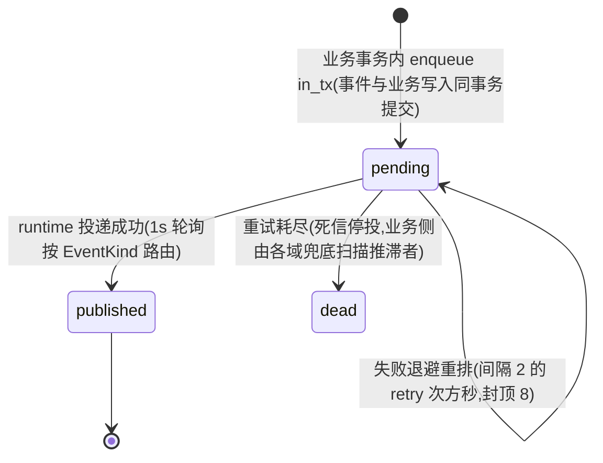

# 07 · 平台基础设施(platform / events / storage / app / assets)

> 覆盖:无业务语义的横切能力、事件层、存储、组合根与前端嵌入。
> 规则归属:配置全量化与环境变量直读禁令(票 16)、22 个环境变量冻结清单(F9)是定案。

## 1. platform —— 无业务语义横切能力(12 模块)

platform 不依赖任何业务模块;**任何模块不得绕过它直读环境变量**。

| 模块 | 职责 | 关键类型/函数 |
|---|---|---|
| config | 环境变量统一收编与校验(分组冻结清单,非法枚举值启动即失败;KNOWN_ENV_VARS 之外启动 WARN) | `Config`、`ListenConfig`、`AuthConfig`、`PaymentMode`/`LoginMode`、`WechatCreds`、`ExportConfig`、`BootstrapConfig` |
| error | 统一错误码表(1xxx 凭证 / 2xxx 业务冲突 / 5xxx 服务端,码值红线) | `Code`、`ApiError`、`FieldErr` |
| httpx | 统一响应信封 `{code,message,data,request_id,trace_id,errors?}` 与 X-Request-ID 规则(红线层) | `Envelope`、`ok`、`error`、`error_with_status`、`not_found_route` |
| ids | 号段模式 ID 分配(内存号段 + 水位 CAS 持久化防回拨,复用 snowflake_state 表;资金场景保留与业务同事务的强一致选项,F4) | `SegmentAllocator`(+`warm_up`)、`uuid_v4` |
| jwt | HS256 双 kind:user 15min / admin 8h | `Kind`、`Claims`、`sign`、`sign_with_sid`、`verify` |
| lifecycle | 受管理后台任务框架,保证「先任务后连接池」停机顺序 | `CancelToken`、`TaskManager` |
| metrics | Prometheus 导出器安装 + 指标 bump | `install()`、`bump` |
| password | bcrypt 口令哈希(与旧版 Go `$2a$` 互通) | `hash`、`verify` |
| redisx | Redis 连接池(deadpool;用途:会话/MFA/频次/租锁) | `Pool`、`open_pool` |
| sessiontoken | 刷新令牌:`<前缀><sid>.<secret>` 编码 + SHA-256 摘要 + Redis Lua 轮换/注销脚本 | `Layout`、`digest`、`ROTATE_SCRIPT`、`REVOKE_SCRIPT` |
| sweeperx | 兜底扫描统一框架:注册 → 统一节拍 → 内存态快照(供诊断端点);扫描器必须幂等 | `SweepRegistry`、`SweepStatus`、`snapshot()` |
| totp | RFC 6238 TOTP(SHA1/6 位/30s/±1 步) | `verify`、`generate`、`otpauth_uri` |

## 2. events —— 领域事件层(契约见 03 第 3 节)

### 2.1 事件生命周期



### 2.2 模块组成

```text
events/src/
├── lib.rs      # EventSource / EventKind(8 值)/ EventDeliveryStatus / EnqueuedEvent
│               # trait EventDispatcher::dispatch(实现必须幂等,at-least-once)
├── enqueue.rs  # in_tx():事务内入队——事件与业务写入同事务提交(可靠投递根基)
├── repo.rs     # domain_event 表访问(本 crate 独占写)
└── runtime.rs  # Registry(按 EventKind 登记 handler)+ 投递循环
                # 1s 轮询 → 路由 → published / 退避重排(1 << min(retry,8) 秒)/ 死信
```

新增一种事件的动作:EventKind 枚举加值 → 产出方在业务事务内 `enqueue::in_tx` → 消费方实现 EventDispatcher 并在 app::serve 注册 → 处理器保证幂等。

## 3. storage —— 连接池与迁移器

- 单库单连接池(F2);所有 DDL 变更改 `migrations/0001_init.sql`(幂等,serve 启动自动执行)。
- `migrator::run_migrations`:启动时自动;`app migrate` 子命令单独升级。

## 4. app —— 组合根

子命令(clap):`serve`(完整服务)/ `migrate`(只跑迁移)。设备模拟器已拆为独立 crate `chargepilot-simulator`(`single`/`batch`,见 08),不进入组合根。

**serve 装配顺序**(main.rs,改装配时保持顺序语义):

1. `Config::from_env()` → `metrics::install()`;
2. MySQL 池(32 连接)→ **自动先跑迁移**;
3. Redis 池(16)→ `SegmentAllocator`(号段 500)预热;
4. `TaskManager`;网关组件:SnapshotStore / TelemetryBuffer / GatewaySink / SessionRegistry;
5. 遥测批量落库循环(200ms 节拍);
6. 设备 TCP 监听(9100,TcpAdapter);
7. 事件投递循环:注册 charge_payment_confirmed → StartDispatcher、device_event → DeviceEventDispatcher;
8. 独立循环:billing-loop(15s)、refund-executor(15s)——快节拍不走 SweepRegistry 统一节拍;
9. SweepRegistry:charging-start-timeout(30s)、export-cleanup(3600s);
10. 后台引导账号(ADMIN_BOOTSTRAP_USER/PASSWORD 非空时 ensure);
11. `PaymentServices::assemble`(PaymentMode 三态)→ ApiDeps(wallet/checkout/charging_stop 恒 Some)→ build_router → HTTP 8080;
12. 停机编排(SIGTERM/SIGINT):HTTP 停止接活 → 遥测冲净 → tasks.shutdown(15s) → 关 Redis → 关 DB。

**加一个新域的装配 checklist**:ApiDeps 加字段(如需条件装配则配 XState FromRef)→ views/<域>/ 门面 → lib.rs merge → app 装配处注入 → 测试 TestAppBuilder 开关。

## 5. assets-admin / assets-h5 —— 前端叶子 crate(F8)

- rust-embed 编译期嵌入前端产物;SPA fallback 到 index.html;
- 产物缺失则对应静态路由整组不挂载;
- 前端源码在 `frontend/admin-web/`(React)与 `frontend/miniprogram/`(Taro),由镜像构建阶段生成产物;
- 前后端契约:请求字段由门禁 `check-api-contract.py` 三段对账(调用点↔路由↔必填字段);响应字段靠集成流断言。

## 6. 改基础设施的注意点

1. **信封与错误码表冻结**(F6):改 httpx/Code 是架构变更,先改蓝图再动代码;
2. 新增环境变量:进 config 冻结清单 + operations.md 的 22 变量表,直读 env 会被门禁/评审拦;
3. 扫描器写进 SweepRegistry 时必须幂等(重复执行安全);快节拍资金循环(billing/refund)保留独立 tokio 循环,不要挪进统一节拍;
4. Redis Lua 脚本(sessiontoken 轮换/注销)与旧版逐字节对齐,改前确认语义等价。
