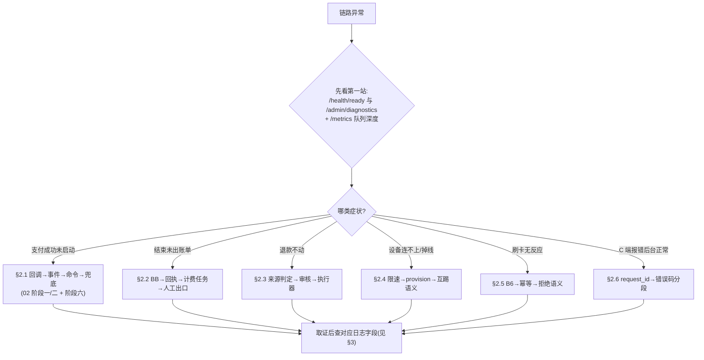

# 09 · 排障索引(链路出问题时先看哪里)

> 覆盖:一条链路「卡住/不动/不一致」时的查证路径。运行手册(部署/数据维护)见 [operations.md](../operations.md);本文只给**代码内**的查证入口。

## 1. 第一站:诊断端点

```
GET /health/live    → 恒 "ok"(进程活着)
GET /health/ready   → "degraded" = MySQL SELECT 1 或 Redis PING 不通
GET /metrics        → Prometheus 全量指标(容量/队列深度/投递重试)
GET /api/v1/admin/diagnostics → 兜底扫描内存态快照 + 各扫描队列深度
                               (SweepRegistry::snapshot,含每个扫描器的最近状态)
```

## 2. 按症状查链路

### 2.0 分诊总图



### 2.1 支付成功但订单没启动

```text
① payment:支付回调到了吗 → payment_callback_idempotent 有行吗(防重放吞掉?)
② events:charge_payment_confirmed 事件 pending/failed?
   → domain_event 表查 status 与 retry 计数(退避 1<<retry 秒,最长 2^8)
③ charging:StartDispatcher 报什么 → 命令 rejected(设备离线)还是异常?
④ 设备侧:charge_command 状态卡在 sent?→ 启动超时兜底扫描(30s)会接管:
   rejected → 订单 refunding → 退款执行器收尾,等一轮再看
⑤ 兜底也没动 → /admin/diagnostics 看 charging-start-timeout 扫描器状态
```

### 2.2 充电结束但没出账单

```text
① BB 帧到了吗 → device_event 表按 device_id 查最近事件
② charge_end_receipt 有行吗 → 没有则回执应用被拒(幂等冲突/状态不符,查日志 ReceiptError::Conflict)
③ charge_billing_job 状态 → pending 卡住看 billing-loop(15s)日志;
   manual_review → 转人工出口(meter_review),后台「电表读数复核」处理
④ 账单签发幂等(uk_order):确认是否已签发只是用户端未读
```

### 2.3 退款不动

```text
① 来源判定:自动(计费余款/启动失败)还是人工(双人审核)还是钱包余额(风控)
② 人工退款:refund_review 状态 awaiting_second?→ 需第二个不同操作者审批
③ 钱包退款:wallet_risk_review 挂起?→ 3 次/5 分钟频次冻结转人工,后台「钱包风控」处理
④ 执行器:refund_record pending?→ refund-executor(15s)日志;
   渠道失败看 payment::wechat 退款构造返回
⑤ 防超退:refunded_cents CHECK 约束拒绝 → 说明金额快照不一致,查计费与退款登记的金额来源
```

### 2.4 设备连不上 / 频繁掉线

```text
① 端口 9100 通不通;accept 限速削峰触发?(突发重连风暴时故意限速)
② 注册被拒 → device_meta 有该设备的 provision 行吗(未导入设备拒绝;simulator 用 --provision 预导入)
③ 同设备二次连接顶替:旧连接被互踢(CloseReason::Replaced)是正常行为,不是故障
④ 会话审计:device_session 表(地址/流量/帧数/unknown_commands)——unknown_commands 高说明帧协议漂移
```

### 2.5 刷卡无反应

```text
① B6 帧到了吗 → device_event 按 card_event 类型查
② card_operation.event_id 幂等:同 event_id 重放会走恢复分支,不是新准入
③ 拒绝原因:SwipeError::is_declined(余额不足保留余额显示,其余无效卡拒绝,BD 帧)
④ 准入未决(Err 非 declined)→ 事件层退避重试;查 card::swipe 日志的锁冲突/存储错误
```

### 2.6 C 端报错但后台正常

```text
① request_id:响应信封里有,拿它 grep 日志定位单次请求全程
② 错误码:1xxx 凭证 / 2xxx 业务冲突 / 5xxx 服务端(platform::error::Code 冻结表);
   503 Storage 类先看 MySQL/Redis
③ 鉴权:401 先分清是 access token 过期(15min,C 端)还是刷新链断了(Redis 会话)
```

## 3. 日志要点(结构化字段)

- 网关层:`device`、`port`、`result_code`、`kind`(事件类型)是标准字段;
- 事件层:入队/投递/退避都带 event_id 与 kind;
- 事务内审计:audit_log 表(module/target/action/actor/client_ip/request_id),后台「审计日志」页可查;
- 告警恢复判定带心跳水位(防乱序重放),乱序告警先看 last_heartbeat_at。

## 4. 兜底扫描清单(谁负责推滞者)

| 扫描器 | 节拍 | 管什么 |
|---|---|---|
| charging-start-timeout | 30s | sent 启动命令超时无回执 → rejected → 退款 |
| export-cleanup | 3600s | 到期导出任务清理(每批 ≤1000,标 expired) |
| billing-loop(独立循环) | 15s | pending 计费任务领取执行;manual_review 转人工 |
| refund-executor(独立循环) | 15s | pending/automatic 到期退款执行 |
| events runtime | 1s | 到期事件投递与退避重排;死信 dead 停投 |

判定「卡住」前先算退避:事件重试间隔 1<<retry 秒(retry 封顶 8 → 最长 256s);扫描器节拍如上。**不要把「还没到重试时间」当故障。**

## 5. 数据修复

- 手工改数前对照 operations.md 的数据维护手册;
- 修复幂等表相关数据时,先确认对应业务事件已终态(dead 的先重置为 pending 才会重投);
- 分区表(charge_order 等)按月分区,修复行注意 created_month 与分区键一致(`month_start_of` 唯一换算来源在 domain)。
